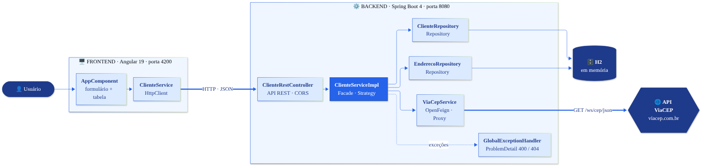
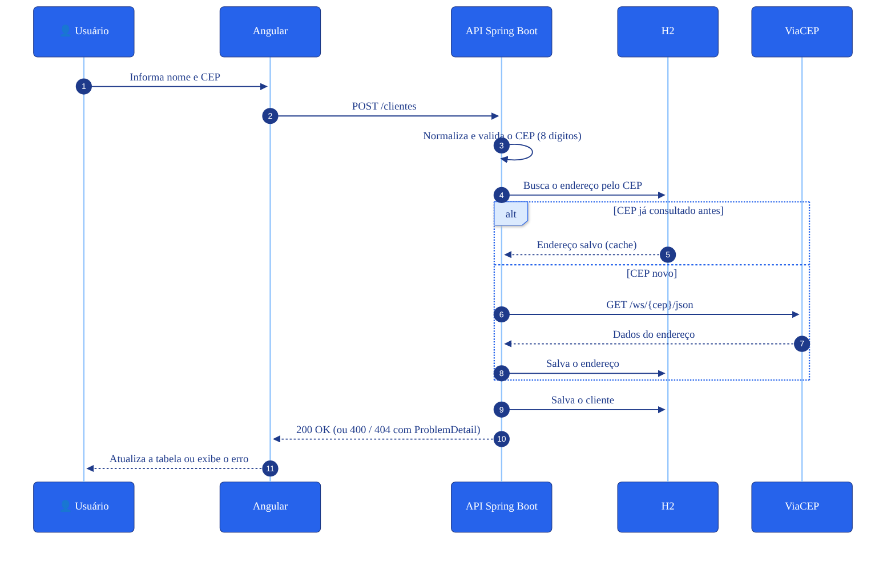

<div align="center">

# 📇 Cadastro de Clientes com ViaCEP

**Aplicação full stack de cadastro de clientes com preenchimento automático de endereço a partir do CEP**

[](https://openjdk.org/projects/jdk/21/)
[](https://spring.io/projects/spring-boot)
[](https://spring.io/projects/spring-cloud-openfeign)
[](https://angular.dev)
[](https://www.typescriptlang.org)
<br>
[](https://www.h2database.com)
[](https://springdoc.org)
[](https://maven.apache.org)
[](https://viacep.com.br)

[](#)
[](https://www.dio.me)
[](https://www.conventionalcommits.org/pt-br/)
[](#-padrões-de-projeto-aplicados)

[Sobre](#-sobre) •
[Funcionalidades](#-funcionalidades) •
[Arquitetura](#-arquitetura) •
[Padrões de Projeto](#-padrões-de-projeto-aplicados) •
[API](#-endpoints-da-api) •
[Como Executar](#-como-executar) •
[Autor](#-autor)

</div>

---

## 📌 Sobre

Projeto desenvolvido como desafio do **Bootcamp DIO & CI&T**, no módulo *Design Patterns com Java: Dos Clássicos (GoF) ao Spring Framework*.

O usuário informa apenas o **nome** e o **CEP** do cliente. O sistema consulta a API pública do [ViaCEP](https://viacep.com.br) e preenche logradouro, bairro, cidade e UF automaticamente.

A base é o lab [lab-padroes-projeto-spring](https://github.com/digitalinnovationone/lab-padroes-projeto-spring), da DIO. A partir dele, o backend foi **migrado para versões atuais**, **bugs foram corrigidos** e uma **interface web em Angular** foi adicionada.

<!-- Sugestão: salve um print da tela em docs/tela.png e descomente as linhas abaixo -->
<!--
<div align="center">
  
</div>
-->

## ✨ Funcionalidades

- ✅ **CRUD completo** de clientes: cadastrar, listar, editar e excluir
- 📍 **Endereço automático** a partir do CEP, via ViaCEP
- 🛡️ **Validação do CEP**: formato (8 dígitos) e existência na base do ViaCEP
- ⚡ **Cache local de endereços**: um CEP já consultado não chama o ViaCEP de novo
- 🚨 **Erros padronizados** no formato *Problem Details* (RFC 9457), exibidos na interface
- 📖 **Documentação interativa** da API com Swagger UI

## 🧱 Arquitetura

<div align="center">
  
</div>

### Fluxo de cadastro de um cliente

<div align="center">
  
</div>

### Estrutura do repositório

```
cadastro-clientes-viacep/
├── docs/                            # Diagramas (PNG + fonte Mermaid)
├── backend/                         # API REST em Spring Boot
│   └── src/main/java/one/digitalinnovation/gof/
│       ├── controller/              # ClienteRestController
│       ├── service/                 # ClienteService, ViaCepService (Feign)
│       │   └── impl/                # ClienteServiceImpl
│       ├── model/                   # Cliente, Endereco e repositórios
│       └── exception/               # Exceções e GlobalExceptionHandler
└── frontend/                        # Interface web em Angular
    └── src/app/
        ├── app.component.*          # Tela única: formulário + tabela
        ├── cliente.service.ts       # Chamadas HTTP à API
        └── cliente.model.ts         # Interfaces Cliente e Endereco
```

## 🧩 Padrões de Projeto Aplicados

| Padrão | Onde | Como |
|---|---|---|
| **Singleton** | Beans do Spring (`@Service`, `@RestController`, repositórios) | O container do Spring cria uma única instância de cada bean e a compartilha. |
| **Strategy** | `ClienteService` → `ClienteServiceImpl` | O controller depende da interface, e a implementação pode ser trocada sem alterar quem a usa. |
| **Facade** | `ClienteServiceImpl` / `ClienteRestController` | Uma interface simples (cadastrar cliente) esconde a orquestração entre o banco H2 e a API do ViaCEP. |
| **Repository** | `ClienteRepository`, `EnderecoRepository` | O acesso a dados é tratado como uma coleção de objetos de domínio (Spring Data). |
| **Proxy** | Spring Data e OpenFeign | O Spring gera em tempo de execução as implementações das interfaces de repositório e do `ViaCepService`. |

**Princípios aplicados**
- **Inversão de Controle (IoC)** e **Injeção de Dependência via construtor**, no backend (Spring) e no frontend (`inject()` do Angular)
- **Inversão de Dependência (DIP)**: o controller depende da abstração `ClienteService`, não da implementação

## 🚀 Melhorias em Relação ao Lab Original

<details>
<summary><b>🔼 Atualização de versões</b></summary>

- Spring Boot 2.5 / Java 11 → **Spring Boot 4.0.8 / Java 21**
- `javax.persistence` → `jakarta.persistence`
- Swagger atualizado para `springdoc-openapi-starter-webmvc-ui` 3.0.3

</details>

<details>
<summary><b>🐛 Correções de bugs</b></summary>

| Problema | Antes | Depois |
|---|---|---|
| `PUT /clientes/{id}` | Criava um novo registro | Atualiza o cliente existente |
| `GET`, `PUT` e `DELETE` com id inexistente | 500 ou 200 | **404 Not Found** |
| CEP inválido ou inexistente | 500 | **400 Bad Request** com mensagem clara |
| Formato do CEP | Salvo como `01001000` ou `01001-000` | Padronizado só com dígitos |
| `id` enviado no `POST` | Podia gerar erro | Ignorado: o cadastro sempre cria um novo cliente |

</details>

<details>
<summary><b>🧹 Qualidade de código</b></summary>

- Injeção de dependência **via construtor** no lugar de `@Autowired` em atributos
- Tratamento centralizado de exceções com `@RestControllerAdvice` e `ProblemDetail`
- CORS liberado apenas para a origem do frontend (`http://localhost:4200`)

</details>

<details>
<summary><b>🆕 Novo</b></summary>

- Interface web em **Angular 19**, com formulário, tabela, edição, exclusão e mensagens de erro

</details>

## 🔌 Endpoints da API

| Método | Rota | Descrição | Respostas |
|---|---|---|---|
|  | `/clientes` | Lista todos os clientes | `200` |
|  | `/clientes/{id}` | Busca um cliente pelo id | `200` `404` |
|  | `/clientes` | Cadastra um cliente | `200` `400` |
|  | `/clientes/{id}` | Atualiza um cliente | `200` `400` `404` |
|  | `/clientes/{id}` | Exclui um cliente | `200` `404` |

**Corpo esperado no `POST` e no `PUT`.** Os demais campos do endereço são preenchidos pelo ViaCEP:

```json
{
  "nome": "Maria da Silva",
  "endereco": { "cep": "01001-000" }
}
```

**Exemplo de resposta de erro:**

```json
{
  "title": "Bad Request",
  "status": 400,
  "detail": "CEP não encontrado: 99999999",
  "instance": "/clientes"
}
```

## 💻 Como Executar

### Pré-requisitos

- ☕ Java 21+
- 🟢 Node.js e Angular CLI 19 (`npm install -g @angular/cli@19`)
- 🌐 Conexão com a internet, para consultar o ViaCEP

### 1. Backend

```bash
cd backend
./mvnw spring-boot:run
```

> No Windows (PowerShell ou CMD), use `mvnw spring-boot:run`. Também é possível executar a classe `Application` pela IDE.

| Recurso | URL |
|---|---|
| API | http://localhost:8080/clientes |
| Swagger UI | http://localhost:8080/swagger-ui.html |

> ℹ️ O H2 é um banco em memória: os dados são apagados a cada reinício da aplicação.

### 2. Frontend

Em outro terminal:

```bash
cd frontend
npm install
ng serve
```

Acesse **http://localhost:4200**. O backend precisa estar rodando.

## 📝 Padrão de Commits

O histórico segue o padrão [Conventional Commits](https://www.conventionalcommits.org/pt-br/), com os escopos `backend` e `frontend`:

| Tipo | Uso |
|---|---|
| `feat` | Nova funcionalidade |
| `fix` | Correção de bug |
| `refactor` | Melhoria de código sem mudar o comportamento |
| `build` | Dependências e versões |
| `docs` | Documentação |
| `chore` | Tarefas de estrutura |

## 🙏 Créditos

- Projeto base: [lab-padroes-projeto-spring](https://github.com/digitalinnovationone/lab-padroes-projeto-spring), de Venilton FalvoJr ([DIO](https://www.dio.me))
- Dados de endereço: [ViaCEP](https://viacep.com.br)

## 👤 Autor

<div align="center">

**André Luiz da Câmara Muniz**

[](https://www.linkedin.com/in/engenheiro-muniz)
[](https://github.com/engenheiromuniz)

🔗 [linkedin.com/in/engenheiro-muniz](https://www.linkedin.com/in/engenheiro-muniz) · [github.com/engenheiromuniz](https://github.com/engenheiromuniz)

⭐ Se este projeto foi útil para você, deixe uma estrela!

</div>
